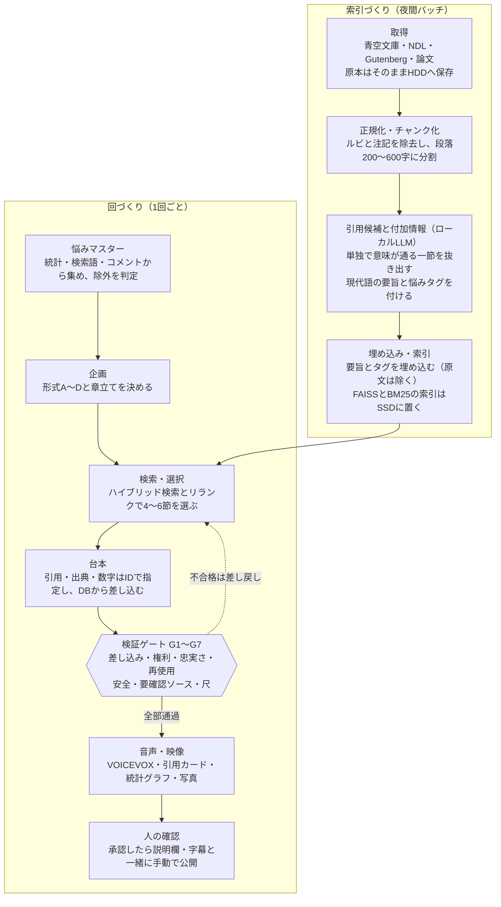

# 「悩み×古典の一節」長尺動画（10分以上） 台本生成パイプライン 仕様書

> 原本：Claude Docs「[「悩み×古典の一節」長尺動画 台本生成パイプライン 仕様書](https://claude.ai/artifact/NG2njSFJVmx4A9EA5qv82i)」（2026-10-21 版）を Markdown に書き出したもの。


## 1. この文書の使い方
この仕様書は、Claude Codeが §13 のマイルストーン順に実装するためのものです。Markdownで書き出し、リポジトリの docs/SPEC.md に置いて使います。

読む順番は次のとおりです。

1. §3 必ず守るルール（権利・安全・量産判定対策）
2. §5 リポジトリ構成とストレージ
3. §7 データモデル
4. §13 マイルストーン。各マイルストーンで関係する節を読む

作業ルールは次の5つです。

- マイルストーンは1つずつ進め、受け入れ条件とテストを満たしてから次へ進む。
- 「要確認」と書いた箇所は、実装前に公式ドキュメントや利用規約で確かめ、結果を docs/decisions.md に記録する。
- §3 の権利ルールと除外ルールを緩める変更はしない。判断に迷ったら止めて人に確認する。
- コーパス・埋め込み・動画などの大きなデータはGitに入れず、設定ファイルで指定したパスに置く。
- 外部サイトへのアクセスは、必ずレート制限とキャッシュを通す。

「必須」は破ってはいけない条件、「既定値」は config/settings.toml で変えられる値です。付録（§15）の CLAUDE.md をリポジトリ直下に置くと、毎回この前提で作業が始まります。

## 2. 目的・スコープ・非目標
10分以上の横型動画で、若年層・社会人の悩み1つ（またはテーマ1つ）を、著作権の切れた古典の一節を複数たどって考える回を、台本から動画まで自動で作ります。10分以上にするのは、8分以上の動画でミッドロール広告を入れられるためです（[出典](https://circleboom.com/blog/midroll-ad)）。

1回の基本形（約12分）は次の流れです。

1. オープニング：今日の悩みと、この回で分かること
2. 悩みの解像度を上げる：公的統計とよくある場面
3. 古典の一節を3〜5つ：原文 → 意味 → 今の悩みへの当てはめ
4. 研究の裏付け（任意）：CC BYの論文だけを使う
5. まとめ：今日からできる小さな一歩
6. エンディング：コメント募集と次回予告

**スコープ内**

- コーパスの取得・正規化・チャンク化（青空文庫から始め、NDL・Project Gutenberg・論文へ広げる）
- 引用候補の抽出と付加情報、埋め込み、ハイブリッド検索、リランク
- 回の企画（テーマ・形式・使う一節の選定）と、章立てつき台本の生成
- 検証ゲート（原文一致・ライセンス・内容の忠実さ・再使用間隔・安全・尺）
- 悩みマスター（収集・正規化・重複排除・除外）
- 音声合成（VOICEVOX）、映像の組み立て、字幕・チャプター・サムネイル・説明欄の生成
- n8nから呼ぶローカルAPIと状態管理

**スコープ外**

- YouTubeへのアップロードと広告位置の設定（手動のまま）
- 既存の市区町村パイプラインの改修
- Shorts（将来、長尺からの切り出しとして検討）

**非目標**

- 医療・診断・服薬、投資・借金などお金の判断、法律相談への助言
- 視聴者個人の悩みへの個別回答

**MVPの完了条件**：青空文庫だけを使った回を3本作り、全てが検証ゲートを通過する。そのうち1本を10分以上の動画として最後まで通す。

## 3. 前提環境と必ず守るルール
実行はM5 Mac上のローカルで行い、権利・安全・量産判定対策の3つを「必須」として実装します。「合成音声＋静止画の長尺」は2026年に収益化停止が相次いだ型なので、人の確認と独自の素材を仕組みとして組み込みます。

| 項目 | 前提 |
|---|---|
| マシン | M5 Mac（macOS）、外付けHDD（保存用）、内蔵SSD（索引・DB） |
| 言語・ツール | Python 3.12以上、uv、ffmpeg、Playwright（テロップ・サムネイルの画像化） |
| 既存資産 | n8n（マスターWF＋サブWF）、VOICEVOXエンジン（ローカルHTTP） |
| 処理時間 | 制約にしない。重い処理は夜間バッチでよい |
| 進め方 | n8nに組み込む前に、まず1本を手で通して検証する |

**権利ルール（必須）**

| ID | ルール |
|---|---|
| R1 | 画面に原文を出せるのは、license が PD_JP・CC0・CC_BY の一節だけ |
| R2 | CC BY-SA・CC BY-ND・NC系・ライセンス不明・著作権ありは、本文を保存も索引化もしない（書誌情報のみ）。著作物を要約して回答を作るRAGには30条の4が使えず、47条の5も軽微な利用に限られる（[文化庁の整理](https://www.bunka.go.jp/seisaku/bunkashingikai/chosakuken/hoseido/r05_05/)）。例外として、日本語版ウィキペディア（CC BY-SA 4.0）の記事は、背景の事実を探す手がかりとしてだけ取得し、HDD の raw/wikipedia/ に置いてよい。索引にせず、台本を書くLLMと判定役には渡さず、文を引用・表示しない。そこから作った事実は、ウィキペディア以外の資料で人が確かめてから使う（D-013） |
| R3 | 1968年以降に亡くなった著者の作品は保護中、1967年以前の没者は保護期間満了（[解説](https://www.watch.impress.co.jp/docs/news/1160111.html)）。訳書は訳者の没年も判定する。資料の台帳（M8a）では、編者・校訂者・訓読者・注釈者・序文や解説を書いた人・増補した人など、関わった人全員の没年を判定する。団体名義だけで公表されたものは公表から数える（53条。1冊ずつ人が確かめる。D-018）。1968年以降の復刻・増補版は、足された部分を人が確かめる |
| R4 | 連合国籍の著者の戦前・戦中の作品は、戦時加算（国ごとに約10〜12年）で保護が続く場合がある（[解説](https://www.itmedia.co.jp/news/articles/0701/25/news121_2.html)）。国ごとの日数を確かめるまで、連合国籍か国籍不明で1955年以降に亡くなった人の作品は自動で満了と判定せず、手動確認へ回す。1941年12月8日の権利者（英米の出版社など）が連合国籍か不明な場合も同じ（D-019） |
| R5 | 外国語の古典は、保護期間満了の訳か自前訳だけを使う。自前訳は画面と説明欄に「試訳」と明記する |
| R6 | 引用文・出典・統計の数字は、DBから機械的に差し込む。LLMに書かせない。著者や作品の背景（経歴・作品の成り立ち・時代）は、DBにある確認済みの事実だけを根拠に、LLMが自分の言葉で語ってよい。そのとき人名・地名・作品名・団体名・年・月・年齢・数は、事実の項目の記号（{{fact:事実ID.項目}}）で差し込む。判定役が1文ずつ事実と照らし合わせ、人が確認する（D-012） |
| R7 | 出典（著者・作品・章・底本またはDOI・URL・ライセンス）を画面と説明欄に入れる。CC BYは改変の有無も書く |

**安全ルール（必須）**

- 医療・診断・服薬、自傷・自殺・摂食、投資・借金・ギャンブルなどお金の判断、法律相談、特定の個人や集団への攻撃に当たる悩みは blocked にし、回を作らない。
- 差別表現・暴力・死の美化などを含む一節には caution を立て、自動選択の対象から外す。
- 論文は「研究ではこういう結果がある」という脇役に限る。臨床集団・診断・治療・薬の研究は使わない。

**量産判定対策（必須）**

YouTubeは2026年7月、テンプレート型で変化の少ない量産を収益化の対象外と明確にし、該当が多いチャンネルは収益化できなくなりました（[TechCrunch](https://techcrunch.com/2026/07/20/youtube-clarifies-policies-around-ai-slop-and-upsetting-videos/)）。日本でも、音声合成とAIで作っていたチャンネルが「大量生産されたコンテンツ」として収益化無効になった例があります（[J-CAST](https://www.j-cast.com/2026/02/03511618.html)）。

- 回の形式を4種以上持ち（§8）、同じ形式を3回続けない。
- 同じ作品は直近10回、同じ著者は直近5回で主役にしない（既定値）。
- 公開前の人の確認を必須にする。台本には人の一言（文字か自分の声）を入れる枠を持つ。
- 映像は自分で撮った写真、保護期間満了の資料画像、統計グラフで作る。AI生成画像と、立ち絵の掛け合い（ゆっくり解説型）は使わない。
- 収益の柱は書籍アフィリとブログ記事にし、広告収益に依存しない。

## 4. 全体アーキテクチャと処理の流れ


処理の流れ · 索引づくり4段、回づくり7段
左の索引づくりは夜間にまとめて回し、右の回づくりは1回ごとに悩みマスターから人の確認まで進みます。検証ゲートで不合格になった台本は、検索・選択に戻って別の候補か再生成になります。

## 5. リポジトリ構成とストレージ設計
コードはGitリポジトリ、本文・埋め込み・動画は外付けHDD、検索時に読む索引とDBは内蔵SSDに置きます。HDDはランダム読みが遅いので、検索やAPIの処理中はHDDを読まない設計にします。

**リポジトリ**

```text
koten-videos/
├─ pyproject.toml
├─ CLAUDE.md                 付録（§15）
├─ .env.example              APIキーの雛形（.env はコミットしない）
├─ docs/
│  ├─ SPEC.md                この仕様書
│  └─ decisions.md           「要確認」の調査結果と判断の記録
├─ config/
│  ├─ settings.toml          パス・モデル・閾値（§11）
│  ├─ sources.yaml           取得対象（NDC・作品リスト・除外作品）
│  ├─ themes.yaml            テーマの統制語彙
│  ├─ stats.csv              公的統計の数値と出典（§9）
│  └─ formats.yaml           回の形式と章の配分（§8）
├─ prompts/                  LLMプロンプト（版番号つき）
├─ templates/                テロップ・カード・サムネイルのHTML
├─ src/koten/
│  ├─ ingest/  normalize/  chunk/  augment/  embed/  index/
│  ├─ worries/  plan/  retrieve/  script/  verify/
│  ├─ voice/  visuals/  render/  publish_kit/  api/
│  ├─ license.py             権利判定（R1〜R5）を1か所に集約
│  └─ cli.py
└─ tests/                    単体テストと小さなフィクスチャ
```

**データの置き場所**

```text
<HDD_ROOT>/koten/            例：/Volumes/KotenHDD/koten
├─ raw/<source>/             取得した原本（zip・XML・JSONのまま）＋ manifest（URL・取得日時・ハッシュ）
├─ clean/<source>/           正規化テキスト（Parquet）
├─ chunks/                   チャンク表（Parquet）
├─ augment/<llm>/<prompt版>/ 引用候補と付加情報（Parquet）
├─ emb/<embed_model>/        埋め込み（float16 の npy シャード＋ID対応表）
├─ snapshots/openalex/       OpenAlex スナップショットの必要部分
├─ media/<episode_id>/       音声・カード画像・中間動画・完成動画
└─ exports/                  レビュー用HTML・CSV

<SSD_ROOT>/koten-hot/        例：~/koten-hot
├─ index/<embed_model>/      FAISS と BM25 の索引
├─ cache/candidates.parquet  検索時に使う引用候補表（HDDからの抜粋）
└─ db/koten.sqlite           悩み・回・台本・使用履歴・状態
```

**HDDの扱い（必須）**

- 書き込みはまとめて行い、小さなファイルを大量に作らない（Parquetの行グループを使い、zipは解凍せず保存する）。
- 検索APIは起動時にSSDの索引と引用候補表をメモリへ読み込み、処理中はHDDに触れない。
- HDDが未接続のときは、取得・付加・埋め込み・レンダリング系のコマンドを止める。検索APIはSSDだけで動かし、状態は `koten doctor` で確認する。

**容量の目安**

| 対象 | 計算 | 目安 |
|---|---|---|
| 埋め込み | 件数 × 次元 × 2バイト（float16） | 50万件・1024次元で約1GB |
| 完成動画 | 8Mbps × 10分 | 約600MB/本 |
| 音声（中間） | 24kHz・16bit・モノラル × 12分 | 約35MB/本 |
| テキスト類 | 取得対象の合計 | 取得後に実測し decisions.md に記録 |

**バックアップ**

- augment/ と emb/ は作り直しに時間がかかるので、週1回別ドライブへ rsync する。
- raw/ は再取得できるので任意。media/ は公開後に完成動画だけ残す。
- SQLiteはSSD上で毎日スナップショットを取り、HDDにも複製する。

## 6. データソース仕様
青空文庫から始め、NDL → Project Gutenberg → 論文の順に足します。どのソースも取得時にライセンスを判定し、R1〜R5を満たさない本文は保存しません。

| ソース | 着手 | 取得方法 | ライセンス判定 | 主な注意点 |
|---|---|---|---|---|
| 青空文庫 | M1 | 作品CSVで対象を選び、テキストzipを取得 | 作品・人物の著作権フラグがともに「なし」→ PD_JP | Shift_JIS・注記形式。新字新仮名版を優先 |
| NDL 次世代デジタルライブラリー | M8 | 公式API（Book API・Page API）でOCR全文を取得 | 収録は保護期間満了の資料のみ → PD_JP | OCRの誤りあり。引用は人が画像と照合 |
| Project Gutenberg | M8 | 公式カタログCSVで選び、本文はミラーから取得 | 著者・訳者の没年で R3/R4 を自前判定 | 本体サイトの自動取得は不可。前後のライセンス文を除去 |
| 論文（PMC OA） | M8（任意） | 発見はOpenAlex、本文はPMCのS3 | CC0・CC BYだけ採用 | 脇役。臨床・治療の論文は除外 |
| 現代の哲学書・一般論文 | — | 取得しない | 著作権あり | 書誌情報だけ references 表へ |

**青空文庫**

- 作品CSV（list_person_all_extended_utf8.zip）には、作品ID・作品名・分類番号（NDC）・文字遣い種別・作品著作権フラグ・没年月日・人物著作権フラグ・テキストファイルURL・底本情報の列がある（[出典](https://qiita.com/ksato9700/items/48fd0eba67316d58b9d6)）。
- 初期対象は NDC 1類（哲学・思想・心理・倫理。159 人生訓を含む）、914（随筆）、915（日記・書簡）と、sources.yaml の作品リスト。例：三木清『人生論ノート』（新字新仮名版あり、[出典](https://forest.watch.impress.co.jp/docs/bookwatch/aozora/1100711.html)）。
- 一括取得はGitHub上の青空文庫ミラーを優先する（要確認：利用条件）。サイトから取る場合は1秒1件以下にする。
- 正規化：ルビ《》と｜を除去、［＃…］の注記を除去、外字注記は代替文字に置換して記録、末尾の「底本：」以降は出典情報として切り出す。
- 同じ作品に旧字旧仮名と新字新仮名があれば、新字新仮名を使う。

**NDL 次世代デジタルライブラリー**

- 公式APIで、保護期間満了の図書約28万点と古典籍約8万点の書誌とOCR全文テキスト（紙面上の座標つき）を検索・取得できる（[API説明](https://lab.ndl.go.jp/service/tsugidigi/apiinfo/)）。保護期間満了の資料は許諾なしで使える（[NDL](https://lab.ndl.go.jp/pdf/event/joss2026/JOSS2026_B3_ndl.pdf)）。
- 利用条件（「ご利用に当たって」）は実装前に確認する（要確認）。
- 狙いは明治・大正の修養書（当時の自己啓発書）や人生論。sources.yaml の検索語とNDCで絞る。
- 出典はPID（info:ndljp/pid/…）とコマ番号で示す。ページ画像は「資料画像カード」に使える。
- OCRの誤りがあるので、NDL由来の一節は review_required=true にし、人がページ画像と照合してから使う。

**Project Gutenberg**

- 本体サイトは人の閲覧用で、プログラムからの取得はミラーを使う方針（[公式方針](https://www.gutenberg.org/policy/robot_access.html)、[解説](https://docs.ropensci.org/gutenbergr)）。カタログ（pg_catalog.csv）で対象を選び、本文はミラーか自前の rsync コピーから取る。
- 本文前後の「*** START OF THE PROJECT GUTENBERG EBOOK」「*** END」の外側を除去する。
- 原著者と訳者の没年がともに1967年以前で、R4に当たらなければ PD_JP とする（例：古い英訳のストア派の著作）。
- 「Project Gutenberg」の名前を動画の売り文句に使わない（商標。出典として記すことの可否は要確認）。
- 画面には自前の日本語訳を「試訳」として出し、原文の英語は説明欄に載せる（任意）。

**論文（任意）**

- 発見はOpenAlex。APIキーが必須で、無料キーで1日1ドル分まで使え、スナップショットは無料（[出典](https://developers.openalex.org/api-reference/authentication.md)）。大量に見るときはスナップショットをHDDに落とす。
- 本文はPMCのS3バケット pmc-oa-opendata（誰でも読める）から取る。記事ごとにXML・テキスト・PDFがあり、日次の在庫CSVもある（[出典](https://pmc.ncbi.nlm.nih.gov/tools/pmcaws/)）。2026年8月から、全文データの取得はFTPからこのクラウドサービスに移った（[出典](https://pmc.ncbi.nlm.nih.gov/tools/textmining/)）。
- 採用条件：CC0かCC BY、レビューかメタ分析を優先、心理・行動・社会の研究に限る（臨床集団・診断・治療・薬は除外）。
- 台本では自分の言葉で要約し、DOIを説明欄に載せる。CC BYの本文を訳して画面に出すときは「改変あり（翻訳）」と書く。

**取得しないもの**

- 現代の哲学書や一般の論文は、本文を取得も索引化もしない（R2）。紹介するときは書名・著者・ISBNまたはDOIだけを references 表に持ち、内容は自分の言葉で述べる。

## 7. データモデル
本文と埋め込みはHDD上のParquet、運用データ（悩み・回・台本・使用履歴）はSSD上のSQLiteに置きます。表どうしは work_id・chunk_id・candidate_id・worry_id・episode_id でつなぎます。

| 表 | 置き場所 | 主な列 | 用途 |
|---|---|---|---|
| works | HDDのParquet（SQLiteに写し） | work_id, source, source_work_id, title, author_ids, translator_ids, ndc, kana_type, lang, base_book, url, license, license_reason, review_required | 作品と権利判定 |
| persons | SQLite | person_id, name, name_yomi, birth_date, death_date, nationality, allied | 著者・訳者。R3/R4の判定に使う |
| chunks | HDDのParquet | chunk_id, work_id, section, seq, text_orig, text_norm, char_start, char_end | 正規化した本文の段落 |
| candidates | HDDのParquet → SSDのcache | candidate_id, chunk_id, quote_text, quote_start, quote_end, context_text, summary_ja, themes, worries, quotability, caution, llm, prompt_ver | 引用候補と付加情報 |
| embeddings | HDDのnpy | candidate_id, model, vector（float16） | 密ベクトル |
| worries | SQLite | worry_id, text_general, situation, emotion, themes, audience, source_type, source_ref, demand_score, cluster_id, status, blocked_reason, enabled | 悩みマスター（§9） |
| stats | SQLite（config/stats.csv から） | stat_id, theme, label, value, unit, survey, year, url | 統計の数値。台本へはIDで差し込む |
| episodes | SQLite | episode_id, format, theme, worry_ids, state, state_msg, plan_json, script_json, verification_json, review_required, reviewer_note, human_take, duration_sec, created_at, published_at | 1回分の動画 |
| usage | SQLite | episode_id, candidate_id, work_id, author_id, role（main/sub） | 再使用間隔の判定 |
| references | SQLite | ref_id, kind（book/paper）, title, authors, isbn, doi, license | 著作権ありの書誌情報 |

**IDの形式**：work_id = `<source>:<元のID>`、chunk_id = `<work_id>#<連番>`、candidate_id = `<chunk_id>/q<連番>`、episode_id = `E<YYYYMMDD>-<連番>`。

**license の値**

- 使用可：PD_JP、CC0、CC_BY
- 本文を保存しない：BLOCKED_SA、BLOCKED_ND、BLOCKED_NC、COPYRIGHTED、UNKNOWN
- 手動確認待ち：NEEDS_REVIEW（R4に当たる作品、団体名義の作品、1968年以降の版）。人が確認して PD_JP か COPYRIGHTED に変える。人の確認で使えるようにできるのは NEEDS_REVIEW だけで、UNKNOWN・COPYRIGHTED は使えるようにしない（データを直して判定し直す）
- NDL の資料は、NDL の公開範囲の表示が「インターネット公開（保護期間満了）」のものだけを使う（2つ目の関門。license.py の結果と比べて厳しいほうを採る）
- 判定が厳しくなって保存できなくなった作品は、次の取得（ingest）で本文を消す
- NDL由来はOCRのため、license とは別に review_required=true を立てる

**回（episodes）の状態**

yet → planned → script_done → voice_done → image_done → composed → reviewed → published の順に進みます。どの段で失敗しても error にし、失敗した段と理由を state_msg に残して、その段から再実行できるようにします。voice_done・image_done・composed の名前は市区町村パイプラインと揃えます。

## 8. 処理パイプライン詳細
索引づくり（夜間バッチ）と回づくり（1回ごと）の2系統です。回づくりではLLMに事実を書かせず、引用・出典・統計はIDで指定させてDBから差し込みます。検証ゲートを全て通った台本だけが音声と映像に進みます。

**8.1 取得**

- 同じURLは再取得しない（ハッシュとETagで判定）。中断しても続きから再開できるようにする。
- 1ホストあたり1秒1リクエスト以下にし、各サイトの方針がそれより厳しければ従う。User-Agentに連絡先を入れる。
- raw/ に原本のまま保存し、manifest にURL・取得日時・ハッシュ・判定したライセンスを書く。

**8.2 正規化とチャンク化**

- ソース別の規則（§6）で本文を整え、text_orig（ルビ・注記を除いた原文）と text_norm（照合用）を両方持つ。text_norm は空白・改行・全角半角の揺れだけを吸収し、漢字は変えない。
- 段落単位で200〜600字にまとめ、文の途中では切らない。章（例：「嫉妬について」）を section に残す。
- 原文中の文字位置（char_start・char_end）を保持し、引用の位置を示せるようにする。

**8.3 引用候補の抽出と付加情報（LLM）**

- 1チャンクから、単独で意味が通る1〜3文の一節を最大3つ抜き出す（20〜120字。既定値）。前後200字程度を context_text として持ち、解説に使う。
- 各一節に、現代語の要旨（60字以内）、テーマ（themes.yaml の統制語彙から1〜3個）、刺さりそうな悩み（3つ、各20字以内）、引用映え（0〜1）、注意フラグを付ける。
- 抜き出した一節が text_orig の部分文字列でなければ破棄する。
- 既定は Mac 上のローカルLLM（OpenAI互換API）で夜間に回す。プロンプトは prompts/ に版番号つきで置き、出力にも版を記録する。
- 出力はJSONスキーマで検証し、壊れていれば2回まで再試行して破棄する。

**8.4 埋め込みと索引**

- 埋め込む文は「現代語の要旨＋刺さりそうな悩み＋テーマ」。古文・文語・英語の原文そのものは埋め込まない。
- モデルは設定で切り替える。候補は multilingual-e5-large（現行）と日本語特化のRuri系。e5には "query: " と "passage: " の接頭辞を付ける。
- 密ベクトルはFAISS（100万件以下は内積の全探索、超えたら近似索引）。BM25はSudachiPyで分かち書きし、同じ文を対象にする。索引はどちらもSSDに置く。

**8.5 回の企画（plan）**

入力は悩みかテーマ（§9の優先度順）、出力は plan_json（形式・章立て・各章で使う候補ID・統計ID）です。形式は formats.yaml で定義します。

| 形式 | 中身 | 一節の数 |
|---|---|---|
| A 悩みを古典で考える | 1つの悩みを、別々の作品の一節でたどる | 4〜6 |
| B 1冊を読む | 1作品（例：『人生論ノート』の1章）を読み、3〜5の悩みに当てはめる | 4〜6（同じ作品） |
| C テーマ回 | 1テーマ（例：孤独）で、3つの悩みに1〜2節ずつ当てる | 4〜6 |
| D 対立する2つの考え | 同じ悩みへの逆の見方を2人の著者で比べ、視聴者に問う | 2〜4 |

候補が足りない（例：A形式で別々の作品が4つ未満）ときは企画を作らず、その悩みを後回しにします。

**8.6 検索・リランク・選択**

- 悩みをLLMで「テーマ（統制語彙）」「言い換え」「理想の一節の要旨（HyDE）」に変換する。例：「同期が先に昇進した」→ テーマ「嫉妬・比較」。
- 3つのクエリでBM25と密ベクトルを引き、RRFで統合して上位50件にする。
- license が使用可、caution なし、再使用間隔（§3）を満たすものに絞る。
- 日本語対応のクロスエンコーダで上位10件に並べ替える（モデルは要確認）。
- 1回で使う一節は、MMRで作品・著者が重ならないように選ぶ（B形式を除く）。最終判断はLLMが理由つきで行う。

**8.7 台本生成**

- LLM（既定はClaude API、設定で切替）が章ごとに台本を書く。引用・出典・統計は `{{quote:<candidate_id>}}`、`{{source:<candidate_id>}}`、`{{stat:<stat_id>}}` のプレースホルダで指定させ、本文の文字列は書かせない。
- プレースホルダは音声化の前にDBの値で置き換える。これで引用文は必ず原文と一致する。
- 文字数は1分あたり300字を初期値とし、VOICEVOXの実測で補正する。12分の回なら約3,600字。
- 回の長さは10〜15分で、目標は12分。長さそのものはおすすめで有利にならないので、水増しして伸ばさない（D-011）。章ごとに目安から±30%を超えたら書き直させ、回全体の見積もりが10〜15分の外なら確認画面に出す。
- 冒頭30秒で「今日の悩み」と「この回で分かること」を言う。最初の30秒（約150字）のうちに {{worry:}} で悩みを言い、挨拶・チャンネルの紹介・登録のお願いを入れない。章の切れ目を広告位置の候補として plan_json に残す。
- タイトル案は、悩みの言葉を前に置き、差し込んだあとで40字以内。著者名・作品名は {{author:}}・{{title:}} の記号で書かせ、DBの値で差し込む。中身で約束できない言い方（絶対・必ず・人生が変わる など）を使わない。条件を満たさなければ、悩みから作る仮のタイトルにして確認画面に出す。
- まとめの章に、人の一言を入れる枠（human_take）を必ず1つ置く。確認時に人が埋めるか、省略を選ぶ。
- 背景の事実（作者の歩み・作品の成り立ち・時代）：企画で、章の一節の作品・作者・訳者についての確認済みの事実を付け（facts 表）、その章でだけ語らせる。名前・年・数は `{{fact:事実ID.項目}}` で書かせ、背景のあとは一節か悩みに戻す。事実のある章は目安に20〜60秒を足し、回の合計は12分のままにする（docs/background_facts_plan.md）。
- 昔の辞書の語釈・時代の解釈（訓読・古い訳・注釈。M8a・D-015）：画像と照らし合わせて確かめた資料のままの本文（dict_entries・renderings 表）を、企画で章に付け、`{{def:J-…}}`・`{{def_src:J-…}}`・`{{interp:I-…}}`・`{{interp_src:I-…}}` で差し込ませる。本文は「」の中に記号だけを置き、同じ段落に出典の記号を置く（出典は「1891年（明治24年）の『言海』」の形）。悩みの文に見出し語がある確かめ済みの語釈は、企画が「悩みの解像度を上げる」章に1つまで自動で付け（20〜30秒を足す）、時代の解釈は `koten ref attach` で人が章に付ける。昔の説明は、その時代の説明として紹介し、今の意味・正しい意味とは言わない。今の辞書・訳注（著作権あり）の名前と本文は語りに出さない（docs/ref_sources.md）。

**8.8 検証ゲート（必須）**

| ゲート | 条件 | 不合格のとき |
|---|---|---|
| G1 差し込み | 全プレースホルダがDBの値に解決でき、「」で囲まれた文は差し込んだ引用・悩み文・語釈・解釈だけ。事実の記号はその章に渡した事実（と前の章で使った事実）だけを指し、語りに年・元号・世紀・「百年前」・事実の項目（人名・地名・作品名など）・書誌の人名を直接書いていない。語釈・解釈の記号は章に渡したものだけを指し、本文は「」の中、同じ段落に出典の記号があり、書名や本文を直接書いていない。「辞書では」「本来の意味」「語源」は語釈・解釈の記号と同じ文だけ。「本当の意味」「通説」「多くの学者」、今の辞書・訳注の名前、「明治の人は」のような時代の人全体の言い方は使わない | 台本を再生成（2回まで）。背景・語釈のせいで直らない章は、それを外して書き直す |
| G2 ライセンス | 使う一節が全て PD_JP・CC0・CC_BY で、訳文は R5 を満たす | その一節を外して企画からやり直す |
| G3 忠実さ | 各一節の解説が、その一節と context_text から言える範囲に収まる（別のLLM呼び出しで判定）。背景の事実・語釈・解釈を使った章は、判定役が1文ずつ種類と根拠の ID を返し、根拠の無い背景の主張や辞書・昔の本の紹介、資料と合わない記号、見せていない資料があれば、コードが不合格にする。一節の言葉の当時の意味を言い切る文にも根拠を求める | 該当章を再生成。背景・語釈のせいで直らなければそれを外して書き直し、それでも2回失敗したら人の確認へ |
| G4 再使用間隔 | 主役の作品・著者が直近の回と重ならない（§3の既定値） | 別の候補へ |
| G5 安全 | 悩みが blocked でなく、一節に caution がない | 回ごと中止 |
| G6 要確認ソース | NDL由来（語釈・解釈を含む）・NEEDS_REVIEW・自前訳を含む回、企画のあとで背景の事実や語釈・解釈の文が変わった・使えなくなった回は review_required=true | 人の確認待ち |
| G7 尺 | 音声合成後の合計が10〜15分で、各章が formats.yaml の範囲内 | 章を伸縮して再生成（2回まで） |

全ゲートの結果を verification_json に保存し、確認画面に出します。ゲートとは別に「視聴の確かめ」（冒頭30秒・タイトル案・尺の見積もり）の結果も保存します。こちらは回を止めず、直らなければ確認画面に注意として出します。

**8.9 音声**

- VOICEVOXの audio_query と synthesis には同じ speaker ID を渡す（市区町村パイプラインで不一致の不具合が出た箇所）。
- 人名・作品名・旧仮名の読みはユーザー辞書に登録してから合成する。
- 新字新仮名の引用は原文を読み上げる。旧字旧仮名や外国語は、画面に原文を出し、読み上げは現代語訳にする。
- 章ごとに wav を作り、長さを実測して timings に記録する。

**8.10 映像**

- 1920×1080・30fps。台本の段落ごとに「ショットリスト」を作り、5〜10秒ごとに絵を切り替える。
- 絵の種類は、自分の写真（ゆっくりズーム）、引用カード（縦書き）、章タイトルカード、統計グラフ（stats表から描画）、著者カード（保護期間満了の肖像のみ）、資料画像カード（NDLのページ画像）の6つ。
- カード類は templates/ のHTMLをPlaywrightで画像にする。縦書きは CSS の writing-mode: vertical-rl を使う。
- 写真は設定したフォルダから選び、同じ写真を直近5回で使わない。
- BGMは商用利用可でYouTubeで使えるものだけを使い、ナレーション中は音量を下げる。
- ffmpegで章ごとに組み立て、最後に結合する。

**8.11 公開用キット**

- 説明欄：導入文、チャプター（各章の開始時刻）、出典一覧、紹介した本の一覧（アフィリ用）、試訳の明記、VOICEVOXのクレジット（キャラクターごとの規約に従う）。
- チャプターの条件（00:00始まり、3つ以上、各10秒以上）は要確認。
- 字幕（SRT）を timings から作る。
- サムネイル（1280×720）をHTMLテンプレートから作る。テーマ語・著者名・自分の写真を使い、テンプレートは3種以上を順に使う。
- 1回につきサムネイル3枚（別々のテンプレート）とタイトル案3つを作り、YouTube Studio の「テストと比較」に掛けられるようにする（勝ちは総再生時間の割合で決まる）。サムネイルの文字は悩みの言葉を短く、タイトルと同じ約束をする。
- 説明欄の最初の2行に、悩みの言葉と「この回で分かること」を書く。
- 終了画面（最後の5〜20秒）とコメント欄の固定コメントで、同じテーマの公開済みの回を1本すすめる。テーマ別の再生リストに入れる。
- 広告位置の候補（章の切れ目の時刻）を確認画面に出す。設定はYouTube Studioで手動で行う。

**8.12 人の確認（必須）**

- 回ごとに exports/ に確認画面（HTML）を出す。中身は台本全文、引用と原文の対応、出典とライセンス、ゲート結果、動画プレビュー、広告位置の候補。
- 人が承認すると reviewed になる。差し戻しはコメントつきで planned か script_done に戻す。

## 9. 悩みマスター
悩みは1行1件で管理し、公的統計でテーマの優先度を、検索データで言い回しを、自分のチャンネルのコメントで生の声を集めます。1回の動画では、1つの悩みか、同じテーマの悩み3つを使います。

| 収集元 | 使い道 | 取り込み方 | 注意 |
|---|---|---|---|
| 公的統計 | テーマの重み | config/stats.csv を年1回、手で更新 | 数値と出典URLを必ず残す |
| 検索データ（Googleキーワードプランナー、Googleトレンド、YouTubeの検索候補、YouTube Studioで見られる視聴者の検索語） | 言い回しと需要 | 手で書き出したCSVを `koten worries import --from csv` で取り込む | 自動スクレイピングはしない |
| 自分のチャンネルのコメント・フォーム | 生の声 | YouTube Data API の commentThreads.list を動画ごとに呼ぶ | 名前・地名など個人が分かる語を除き、そのまま使わず一般化する |
| Q&Aサイト（知恵袋・発言小町・Redditなど） | 傾向の把握 | 人が読み、一般化した文を手で入力する | 自動収集・転載はしない |
| 昔の人生相談（任意） | 差別化 | NDLの保護期間満了資料で見つかった場合だけ使う | 新聞社の有料DBは使わない。例：読売の人生相談欄は大正3年に「身の上相談」として始まった（[出典](https://www.maruzenjunkudo.co.jp/products/9784790717423)） |

**正規化（LLM）**

- 出力は、悩み文（一般化、40字以内）、状況、感情、テーマ（統制語彙から1〜3個）、対象層（学生・新社会人・中堅・管理職）、除外カテゴリの判定。
- 例：「同期が先に昇進して、素直に喜べない」→ 状況「職場の昇進」、感情「嫉妬・焦り」、テーマ「嫉妬・比較」、対象「中堅」。

**重複排除**：埋め込みのコサイン類似度0.92以上を同じクラスタにまとめ、代表1件を残します（既定値）。同じクラスタの悩みは30日以内に主役にしません。

**除外（必須）**：§3の安全ルールに当たる悩みは status=blocked にします。LLMの判定に加えて、キーワード辞書でも二重に確認します。

**優先度**：スコア = テーマの重み × 需要 × 新しさ（前回使ってからの日数で上がる）。企画（§8.5）はスコアの高い順に、候補の一節が足りるものから採ります。

**stats.csv の初期値**（重みは人が決め、下の数値はその根拠として持つ）

| stat_id | テーマ | 内容 | 値 | 出典 |
|---|---|---|---|---|
| rodo_r7_amount | 仕事の量 | 強い不安・ストレスの内容（労働安全衛生調査、令和7年） | 39.5% | [労働新聞](https://www.rodo.co.jp/series/225471/) |
| rodo_r7_failure | 失敗・責任 | 同上 | 39.5% | [労働新聞](https://www.rodo.co.jp/series/225471/) |
| rodo_r7_relations | 職場の人間関係 | 同上。前年から6.8ポイント増 | 32.9% | [労働新聞](https://www.rodo.co.jp/series/225471/) |
| funso_r7_harassment | いじめ・嫌がらせ | 民事上の個別労働紛争の相談件数（令和7年度、14年連続最多） | 55,614件 | [厚生労働省](https://www.mhlw.go.jp/stf/houdou/newpage_00235.html) |
| nf_2026_future | 将来への不安 | 17〜19歳で「自国の将来は良くなる」と答えた割合 | 16% | [日本財団](https://webtan.impress.co.jp/r/prtimes/items/000000511.000025872) |
| gakujo_2025_jobchange | 転職の迷い | 20代の転職希望者で「転職すべきか迷った」割合 | 7割超 | [学情](https://service.gakujo.ne.jp/wp-content/uploads/2025/08/250901-rekatsuenq.pdf) |
| cao_loneliness | 孤独 | 孤独感は若年・中年層で高く、20代は男女とも高い | 報告書から転記（転記するまで stats.csv に入れない。2026-10-25） | [内閣府](https://www.cao.go.jp/kodoku_koritsu/torikumi/yushikisha_arikata/dai5/pdf/siryou1-1.pdf) |

## 10. 台本JSONスキーマ
台本JSONが、このパイプラインとn8n・レンダラーの間の唯一の受け渡し形式です。スキーマ（src/koten/script/schema.json）に合わないものは、その時点で state を error にします。

```json
{
  "schema_version": "1.0",
  "episode_id": "E20261101-01",
  "format": "A",
  "title": "（仮）同期の昇進を素直に喜べないとき、古典はどう考えたか",
  "theme": ["嫉妬", "比較"],
  "worries": [
    {"worry_id": "W0123", "text": "同期が先に昇進して、素直に喜べない"}
  ],
  "chapters": [
    {
      "chapter_id": "ch0",
      "role": "opening",
      "title": "オープニング",
      "target_sec": 45,
      "segments": [
        {"seg_id": "ch0-s1", "kind": "narration",
         "text": "（今日の悩みと、この回で分かること）",
         "visual": {"type": "photo", "ref": null}}
      ]
    },
    {
      "chapter_id": "ch1",
      "role": "context",
      "title": "悩みの解像度を上げる",
      "target_sec": 90,
      "segments": [
        {"seg_id": "ch1-s1", "kind": "stat",
         "text": "{{stat:rodo_r7_relations}}",
         "visual": {"type": "chart", "ref": "rodo_r7_relations"}}
      ]
    },
    {
      "chapter_id": "ch2",
      "role": "classic",
      "title": "（章タイトル）",
      "target_sec": 120,
      "segments": [
        {"seg_id": "ch2-s1", "kind": "quote",
         "text": "{{quote:aozora:XXXX#12/q1}}",
         "read_as": "original",
         "visual": {"type": "quote_card", "ref": "aozora:XXXX#12/q1"}},
        {"seg_id": "ch2-s2", "kind": "narration",
         "text": "（一節の意味と、今の悩みへの当てはめ）",
         "visual": {"type": "photo", "ref": null}}
      ],
      "sources": ["aozora:XXXX#12/q1"]
    }
  ],
  "human_take": {"chapter_id": "ch5", "text": null, "audio_path": null},
  "comment_prompt": "（視聴者への問いかけ）",
  "featured_books": [{"work_id": "aozora:XXXX", "query": "（書名と著者）"}],
  "ad_break_candidates_sec": null,
  "review_required": false,
  "verification": null,
  "timings": null
}
```

**項目の決まり**

- kind は narration（地の文）、quote（引用）、stat（統計）、transition（章の区切り）の4つ。quote と stat の text はプレースホルダだけを入れる。
- read_as は original（原文を読む）か modern（現代語訳を読み、画面は原文）。旧字旧仮名と外国語は modern にする。
- visual.type は photo、quote_card、title_card、chart、author_card、page_image の6つ。
- 外国語の一節は、candidates 側に自前訳を持ち `{{quote_ja:<candidate_id>}}` で差し込む。画面には「試訳」を自動で付ける。
- timings・ad_break_candidates_sec・verification は後段が埋める。台本を書くLLMは触らない。
- 説明欄・チャプター・字幕は publish_kit が timings から作るので、台本JSONには持たない。

## 11. CLI・API・設定
全ての処理はCLIで単独に実行でき、n8nはローカルAPI経由で同じ処理を呼びます。最初はCLIで1本を手で通し、その後でn8nにつなぎます。

**CLI**

| コマンド | 内容 |
|---|---|
| `koten doctor` | HDD・SSD・VOICEVOX・LLM・埋め込みモデルの疎通と空き容量を表示 |
| `koten ingest <source> [--limit N]` | 原本を取得して raw/ へ保存 |
| `koten normalize <source>`、`koten chunk <source>` | 正規化とチャンク化 |
| `koten augment [--limit N] [--resume]` | 引用候補の抽出と付加情報（夜間向け） |
| `koten embed --model <name>`、`koten index build --model <name>` | 埋め込みと索引づくり（索引はSSD） |
| `koten worries import --from <csv または comments>`、`koten worries normalize` | 悩みの取り込みと、正規化・重複排除・除外 |
| `koten retrieve --worry <id> --explain` | 上位候補、選んだ理由、ゲート結果を表示 |
| `koten plan --worry <id> [--format A]` | 回の企画（plan_json）を作る |
| `koten script --episode <id>` | 台本JSONを作り、G1〜G6を実行 |
| `koten voice --episode <id>`、`koten render --episode <id>` | 音声合成（G7を含む）と映像の組み立て |
| `koten kit --episode <id>` | 説明欄・チャプター・字幕・サムネイルを作る |
| `koten review export --date <YYYY-MM-DD>` | 確認画面（HTML）を出す |
| `koten eval retrieval` | 評価セットで検索の指標を出す |

**API**（FastAPI、127.0.0.1のみで待ち受ける）

| メソッド | パス | 内容 |
|---|---|---|
| GET | /healthz | 疎通確認 |
| POST | /v1/episodes/next | 優先度順に次の悩みを選び、企画と台本を作る（script_done） |
| POST | /v1/episodes/{id}/voice | 音声合成（voice_done） |
| POST | /v1/episodes/{id}/render | 映像の組み立て（image_done → composed） |
| GET | /v1/episodes/{id} | 台本・ゲート結果・状態を返す |
| POST | /v1/episodes/{id}/state | 状態とメッセージを更新する |

音声と映像は時間がかかるので非同期ジョブにし、n8nのマスターWFは状態をポーリングして次の段を呼びます。

**設定（config/settings.toml）**

```toml
[paths]
hdd_root = "/Volumes/KotenHDD/koten"
ssd_root = "~/koten-hot"
photos_dir = "~/Pictures/koten-bg"
bgm_dir = "~/Music/koten-bgm"

[llm.augment]                 # Mac上のローカルLLM（OpenAI互換API）
provider = "openai_compatible"
endpoint = "http://127.0.0.1:1234/v1"
model = "要確認"

[llm.script]
provider = "anthropic"
model = "claude-sonnet-5-5"

[llm.judge]                   # G3 忠実さの判定
provider = "anthropic"
model = "claude-haiku-5-5"

[embed]
model = "intfloat/multilingual-e5-large"
dtype = "float16"

[rerank]
model = "要確認"

[episode]
min_sec = 600
max_sec = 900
chars_per_min = 300
same_format_in_row_max = 2

[recency]
work_episodes = 10
author_episodes = 5
photo_episodes = 5
worry_cluster_days = 30

[voicevox]
endpoint = "http://127.0.0.1:50021"
speaker_id = 3

[video]
width = 1920
height = 1080
fps = 30
bitrate = "8M"

[rate_limit]
per_host_per_sec = 1
```

APIキー（ANTHROPIC_API_KEY、OPENALEX_API_KEY、YOUTUBE_API_KEY）は .env に置き、コミットしません。

## 12. 品質評価とテスト
検索は評価セットの数字で、台本はゲート通過率と人の承認率で、公開後は視聴維持率で良し悪しを見ます。結果は docs/decisions.md に記録して比べます。

**評価**

- 評価セット：悩み50件（M4では20件から始める）に、人が「合う一節」を3段階で付ける。tests/eval/retrieval.csv に置く。
- 検索の指標：nDCG@10 と Recall@20。
- 比べる組み合わせ：埋め込みモデル（e5／Ruri系）、付加情報の有無、リランクの有無、HyDEの有無。
- 台本の指標：G1〜G7の通過率、再生成の回数、人の承認率、差し戻しの理由。
- 公開後（任意）：YouTube Studioから書き出したCSV（視聴維持率・平均視聴時間・クリック率）を取り込み、形式ごとに比べる。30秒時点の維持率（Studio の「イントロ」）も、取れる範囲で取り込む。
- 公開10本ごとに、平均視聴率・平均視聴時間・イントロを、尺・形式・タイトルの型で比べ、尺の範囲（10〜15分）と形式の配分を見直す（D-011）。

**単体テスト（必須）**

- ルビ・注記・外字注記の処理と、「底本：」以降の切り出し
- ライセンス判定の境界：1967年没と1968年没、連合国籍の1957年没と1958年没、訳者だけが保護中のケース
- G1の照合：改行・全角半角の揺れ、未解決のプレースホルダ、「」内の作り話の検出
- 台本JSONのスキーマ検証、再使用間隔、同じ形式の連続
- 尺の計算：timings から合計時間とチャプター時刻を出す

**結合テスト**：青空文庫の3作品だけを入れた小さなフィクスチャで、ingest から kit までを通します。LLMはテスト用の固定応答に差し替えます。

## 13. マイルストーンと受け入れ条件
M0からM9を順に進めます。M6で1本を最後まで手で通してから、M7でn8nにつなぎます。

- **M0 土台**：uv・pytest・ruff・設定の読み込み・`koten doctor` を用意する。受け入れ：HDD・SSD・VOICEVOX・LLMの状態と空き容量が表示され、テストが動く。
- **M1 青空文庫の取得・正規化・チャンク化**：受け入れ：NDC 1類・914・915と指定作品が chunks に入る。『人生論ノート』が章ごとに分かれ、ルビと注記が残っていない。
- **M2 引用候補・付加情報・埋め込み・索引**：受け入れ：中断から再開できる。抜き出した一節の原文一致率が100%（不一致は破棄済み）。索引がSSDにでき、APIがHDDを読まずに起動する。
- **M3 悩みマスター**：受け入れ：シード30件が正規化され、除外カテゴリが blocked になり、似た悩みがクラスタにまとまる。stats.csv が読み込まれる。
- **M4 検索と企画**：受け入れ：`koten retrieve` が上位候補と理由を返す。評価セット20件で nDCG@10 を記録する。4つの形式それぞれで plan_json が作れる。
- **M5 台本と検証ゲート**：受け入れ：青空文庫だけで3回分の台本が、スキーマ検証とG1〜G6を全て通る。プレースホルダが全て解決し、出典とライセンスが入っている。
- **M6 1本を手で通す**：受け入れ：10〜15分・1920×1080のmp4ができる（G7）。引用カード・統計グラフ・自分の写真が入り、説明欄・チャプター・字幕・サムネイルがそろう。人が確認画面で承認できる。
- **M7 n8n連携**：受け入れ：n8nのマスターWFから next → voice → render → 状態更新まで1回通る。失敗時は error と理由が残り、その段から再実行できる。
- **M8 ソース拡張**：受け入れ：NDLとProject Gutenbergが入り、NDL由来の一節は review_required になる。論文はCC0とCC BYだけが入る。
- **M9 コメント取り込みと振り返り**：受け入れ：自分の動画のコメントから悩み候補ができ、匿名化と除外判定を通る。YouTube StudioのCSVを取り込み、形式ごとに比べられる。

## 14. リスクと対策
一番大きいリスクは、量産型と判定されてチャンネル単位で収益化が止まることです。次に、権利の誤判定と、AIが存在しない引用を作ることです。

| リスク | 対策 |
|---|---|
| 量産型と判定され、収益化が止まる | 4つの形式を回し、作品・著者・写真の再使用に間隔を置く。人の確認と一言を必須にし、自分の写真・資料画像・統計で映像を作る。収益の柱は書籍アフィリとブログ |
| 権利の誤判定 | 判定を license.py に集約し、境界のテストで固定する。R4とNDLは手動確認に回す |
| 存在しない引用・出典・数字が混じる | 引用・出典・統計はプレースホルダでDBから差し込む（R6）。G1で「」内の作り話を検出する |
| 解説が原文の意味からずれる | G3で別のLLM呼び出しが忠実さを判定し、2回失敗したら人の確認へ回す |
| OCRの誤り | NDL由来は、人がページ画像と照合してから使う |
| センシティブな悩みを扱ってしまう | 除外カテゴリをLLMとキーワード辞書の二重で判定し、生成前に止める |
| 長尺で視聴が続かない | 冒頭30秒でこの回の結論を予告し、5〜10秒ごとに絵を切り替える。公開後の視聴維持率で形式を見直す |
| 外部サイトへの負荷・規約違反 | レート制限・キャッシュ・ミラーを使う。利用条件の確認結果を decisions.md に残す |
| HDDの故障 | augment/ と emb/ を週1回別ドライブへ複製する。raw/ は再取得できる |
| API料金 | 付加情報づけはローカルLLMで行う。OpenAlexはスナップショットを優先し、APIは無料枠の範囲に抑える |

## 15. 付録：CLAUDE.md のひな形
下の内容をリポジトリ直下の CLAUDE.md に置くと、Claude Code が毎回この前提で作業を始めます。

```markdown
# koten-videos

悩み×古典の一節で10分以上の長尺動画を作るパイプライン。仕様は docs/SPEC.md。

## 進め方
- docs/SPEC.md §13 のマイルストーン順に進める。1つ終えるごとにテストを通し、受け入れ条件を確認してから次へ
- 「要確認」の箇所は実装前に公式ドキュメント・利用規約で確かめ、結果を docs/decisions.md に書く
- 判断に迷ったら実装を止めて質問する

## 絶対に守ること
- 権利判定（src/koten/license.py、SPEC §3 の R1〜R7）を緩めない・迂回しない
- 引用・出典・著者情報・統計の数字はDBから差し込む。LLMに書かせない
- 除外カテゴリ（医療・自傷・お金の判断・法律相談など）の悩みで回を作らない
- 大きなデータはGitに入れない。HDD/SSDのパスは config/settings.toml から読む
- 検索・APIの処理中にHDDを読まない（索引とDBはSSD）
- 外部サイトへのアクセスは必ずレート制限とキャッシュを通す
- VOICEVOXの audio_query と synthesis には同じ speaker ID を渡す

## よく使うコマンド
- uv run pytest
- uv run ruff check .
- uv run koten doctor
```

## 16. 出典
2026年10月21日時点で確認した資料です。「要確認」の項目は、実装時に改めて一次情報を見ます。

- [青空文庫のデータ構造について（Qiita）](https://qiita.com/ksato9700/items/48fd0eba67316d58b9d6)
- [青空文庫の新着情報：三木清「人生論ノート」新字新仮名版（窓の杜）](https://forest.watch.impress.co.jp/docs/bookwatch/aozora/1100711.html)
- [次世代デジタルライブラリーのAPIについて（NDLラボ）](https://lab.ndl.go.jp/service/tsugidigi/apiinfo/)
- [国立国会図書館におけるデータ等のオープン化の取組（NDLラボ）](https://lab.ndl.go.jp/pdf/event/joss2026/JOSS2026_B3_ndl.pdf)
- [Project Gutenberg Robot Access Policy](https://www.gutenberg.org/policy/robot_access.html)
- [gutenbergr（rOpenSci）](https://docs.ropensci.org/gutenbergr)
- [OpenAlex Authentication & Pricing](https://developers.openalex.org/api-reference/authentication.md)
- [PMC Article Datasets on AWS](https://pmc.ncbi.nlm.nih.gov/tools/pmcaws/)
- [PMC Article Datasets](https://pmc.ncbi.nlm.nih.gov/tools/textmining/)
- [文化審議会 著作権分科会 法制度小委員会（第5回）](https://www.bunka.go.jp/seisaku/bunkashingikai/chosakuken/hoseido/r05_05/)
- [著作物等の保護期間延長の解説（Impress Watch）](https://www.watch.impress.co.jp/docs/news/1160111.html)
- [戦時加算について（ITmedia）](https://www.itmedia.co.jp/news/articles/0701/25/news121_2.html)
- [YouTube clarifies policies around AI slop and upsetting videos（TechCrunch）](https://techcrunch.com/2026/07/20/youtube-clarifies-policies-around-ai-slop-and-upsetting-videos/)
- [投資系YouTuber、収益化無効を報告（J-CAST）](https://www.j-cast.com/2026/02/03511618.html)
- [Midroll ads（Circleboom）](https://circleboom.com/blog/midroll-ad)
- [令和7年 労働安全衛生調査（労働新聞）](https://www.rodo.co.jp/series/225471/)
- [令和7年度 個別労働紛争解決制度の施行状況（厚生労働省）](https://www.mhlw.go.jp/stf/houdou/newpage_00235.html)
- [日本財団18歳意識調査 第78回（Web担当者Forum）](https://webtan.impress.co.jp/r/prtimes/items/000000511.000025872)
- [学情 20代の転職意向調査（2025年）](https://service.gakujo.ne.jp/wp-content/uploads/2025/08/250901-rekatsuenq.pdf)
- [人々のつながりに関する基礎調査 4年分の分析（内閣府）](https://www.cao.go.jp/kodoku_koritsu/torikumi/yushikisha_arikata/dai5/pdf/siryou1-1.pdf)
- [読売新聞「人生案内」の由来（丸善ジュンク堂）](https://www.maruzenjunkudo.co.jp/products/9784790717423)
